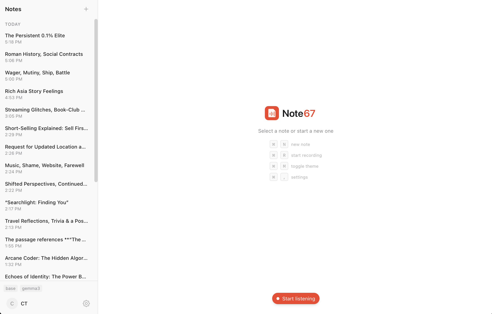
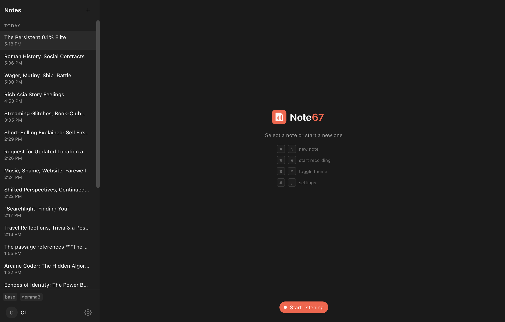
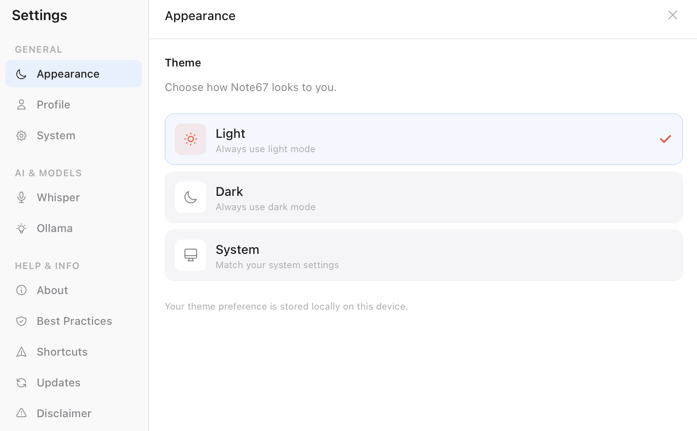
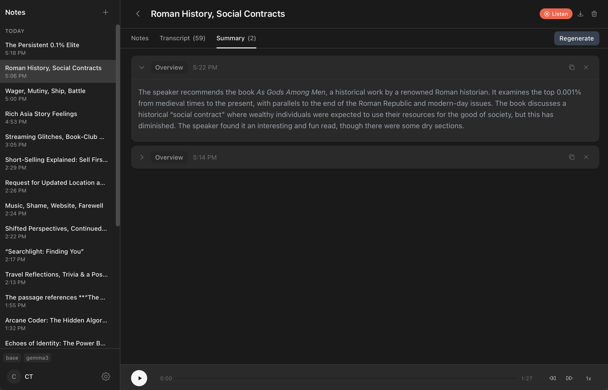

# [](https://note67.com)

[Visit Website](https://note67.com)

<a href="https://www.producthunt.com/products/note67-private-meeting-notes-assistant?utm_source=badge-follow&utm_medium=badge&utm_souce=badge-note67" target="_blank"></a>

**🚀 We're on Product Hunt!** If you find Note67 useful, please consider [upvoting us on Product Hunt](https://www.producthunt.com/products/note67-private-meeting-notes-assistant) — it helps others discover the project!

A private, local meeting notes assistant. Capture audio, transcribe locally with Whisper, and generate AI-powered summaries — all on your device.

## What's New (v0.1.29)

- Security — Note67's window can no longer make the app read, write or delete files outside Note67's own folders; deleting a note deletes only its own recording, and importing audio reads only the file you picked
- Security — transcription models are checked against their published checksum after downloading, and a failed download is no longer saved as the model
- Security — updated the editor's paste handling and HTML sanitizer for a cross-site scripting advisory, and the secure-connection and updater libraries for their advisories
- Only images (PNG, JPEG, GIF, WebP, BMP, AVIF) can be pasted into a note; other files, including SVG, are refused
- Microphones that deliver only 24- or 32-bit audio can record
- Fixed a transcript failing when Whisper splits a Chinese, Japanese or Korean character or an emoji across two lines
- Imported MP3 and Ogg files convert to their exact length, and a PDF export that fails to save now says so
- Updated Tauri, SQLite, whisper.cpp and the audio libraries; OpenSSL is no longer bundled

### v0.1.28

- Meeting detection can be turned off in Settings > System — it prompts once per call, never during a recording, and not just because Teams or Discord is open
- The meeting prompt shows even when Note67 is closed to the menu bar, and goes away a couple of minutes after the call ends
- Uploaded audio is transcribed as soon as it's added, and stopping a recording while an upload is transcribing no longer skips the recording's final transcription
- Deleting a task can be undone for a few seconds, subtasks included, and deleting a note tells you how many tasks go with it
- Overdue tasks are highlighted in a note's Tasks tab too, and task checkboxes work with the keyboard and screen readers
- Links in summaries, Settings and first-run setup open in your browser (the Settings and setup links had done nothing since 0.1.22)
- When Retranscribe fails, Note67 says why and keeps the transcript you had
- Fixed Note67's window not coming back after it started at login, and clicking through a task's details marking it as edited
- Security — Note67's window reaches only your recordings and the files you choose to save, and HTML in a note, transcript or AI summary can't run code or send the window elsewhere
- Privacy — images from the web no longer load in notes or summaries, so an AI summary can't use one to send your notes somewhere; images you paste still show
- Security — updated the secure-connection library the updater uses for a security advisory
- About 2,500 lines of unused code and five unused libraries removed

### v0.1.27 (included in 0.1.28)

- Fixed the app quitting after a recording when the summary contained Chinese, Japanese or Korean text, or an emoji or em dash in the wrong place
- Fixed the app quitting when opening a note that another note mentions near non-English text (the "unlinked mentions" panel behind it is removed)
- Fixed microphone-only recordings ending with an empty transcript and losing everything recorded before a pause, and continuing an older recording overwriting it
- Non-English meetings are no longer re-transcribed in English after Stop — your transcription language is used everywhere
- Notes typed during a meeting are saved as you type and before the summary is written, and clearing a note's text now sticks
- Only one recording runs at a time, so a second one can no longer file a meeting's audio under the wrong note
- Recording no longer needs Ollama — a transcription model is enough, and Ollama adds summaries, titles and tasks when it's running
- Summarize no longer renames notes you've titled yourself, and search works with hyphens, apostrophes, dots and email addresses
- Finding tasks reads the whole of a long meeting without adding the same task twice, and tasks you add yourself no longer turn overdue the next day
- Uploaded audio plays and transcribes on notes without a recording, and mono `.m4a` files such as voice memos convert at full length
- Right-click in the editor shows the normal Cut, Copy, Paste and spelling menu
- Coming in 0.2 — Note67 focuses on meeting notes: the graph view, hashtags, backlinks, the Cmd+J writing sidebar and PDF export are going away (Markdown export stays), and nothing you wrote is deleted

### v0.1.26

- Security — updated bundled third-party components to patch five known vulnerabilities, including the sanitizer that cleans pasted content in the editor

### v0.1.25

- Fixed your own voice missing from the transcript — quiet microphones are now boosted before transcription instead of being treated as silence
- Fixed short replies like "hello" or "thanks" being dropped from the live transcript
- Fixed speech being discarded when you talk at the same time as the meeting audio
- Whisper's stage directions (`*Slow's voice*`, `*sighs*`) no longer show up as transcript lines
- Live transcription now appears below earlier recordings instead of jumping to the top, and stays in view as it arrives
- Fixed silent playback audio when continuing a recording
- Retranscription no longer loses your existing transcript if it's interrupted
- Recommended transcription model is now Turbo Q8 — same quality and speed, half the download
- Faster startup and a smaller app bundle

### v0.1.24

- Tasks — turn a meeting's action items into a real to-do list, or add standalone tasks; each task has a due date, description, and subtasks
- Central Tasks page — open tasks from every meeting in one place, grouped by date (Overdue / Today / Tomorrow / Future) with quick filters
- AI "Generate" pulls action items straight from a meeting into your task list; click a task to jump back to its note
- Smarter summaries — when you take your own notes, the AI summary now expands them with detail from the transcript instead of ignoring them
- First-run setup wizard — guided setup for the transcription model, AI assistant, and microphone/screen permissions

### v0.1.23

- Sentence-based transcript formatting — long monologues break into readable sentences instead of one block of text
- Interval timestamps — a timestamp every 30 seconds within a speaker turn for easier navigation
- Fixed transcript ordering — the last line no longer jumps to the top after post-recording enhancement
- Smarter noise filtering — drops Whisper hallucinations (stray punctuation, repeated "Thank you", stuck words) on silence
- Improved echo handling — better removal of mic pickup of speaker audio when not using headphones
- Transcript search no longer breaks on special characters

### v0.1.22

- Listen-only recording mode — capture system audio without microphone
- Record meetings when mic is unavailable or only system audio is needed
- Live transcription support in listen-only mode
- Improved loading indicator during post-recording retranscription

### v0.1.21

- Wiki-style links — type `[[Note Title]]` to link between notes
- Link aliases — use `[[Title|display text]]` syntax for custom link text
- Link preview on hover — see snippet, click to navigate
- Link autocomplete — type `[[` to see note suggestions
- Backlinks panel — see which notes link to the current note
- Unlinked mentions — find notes that mention this note's title without `[[]]`
- Auto-update links when note title changes
- Hashtag support — type `#tag` in notes for auto-extraction and filtering
- Tag autocomplete — type `#` to see suggestions with keyboard navigation
- Auto-generated tag colors based on tag name
- Global search (`Cmd+K`) — full-text search across all notes with highlights
- Updated recommended Ollama model to Gemma 4

### v0.1.20

- Whisper large-v3-turbo model — 8x faster, similar accuracy to large-v3
- Quantized model variants (Q8) — smaller downloads, lower memory usage
- Changed recommended model to large-turbo for better transcription quality

### v0.1.19

- Minor bug fixes and performance improvements

### v0.1.18

- AI writing assistant sidebar — improve, summarize, expand, or rewrite notes with AI
- Quick actions: Summarize, Action Items, Improve, Expand, Fix Grammar, Bullets
- Chat interface for custom AI requests
- Insert or replace note content with AI-generated text
- Keyboard shortcut `Cmd+J` to toggle AI sidebar

## Features

- [x] Meeting management (create, end, delete)
- [x] SQLite database for local storage
- [x] Audio recording (microphone)
- [x] Local transcription with Whisper
- [x] Speaker distinction (You vs Others) on macOS
- [x] Echo deduplication for speaker usage
- [x] Live transcription during recording
- [x] Auto-retranscribe after recording for improved accuracy
- [x] Pause/Resume recording
- [x] Continue recording on existing notes (Listen)
- [x] Listen-only mode (system audio without microphone)
- [x] Upload external audio files for transcription (mp3, m4a, aac, flac, ogg, wav, mkv, mp4; Opus audio isn't supported yet)
- [x] Download and delete audio files
- [x] Reorder audio files with up/down controls
- [x] Retranscribe audio with different Whisper model
- [x] Voice Activity Detection (VAD) for mic input
- [x] Automatic filtering of blank/noise segments
- [x] Transcript viewer with search and speaker filter
- [x] AI-powered summaries via Ollama
- [x] Smarter summaries that expand your own notes using the transcript
- [x] AI writing assistant sidebar (improve, summarize, expand notes)
- [x] Tasks with due dates, descriptions, and subtasks
- [x] Central Tasks page grouped by date (Overdue / Today / Tomorrow / Future)
- [x] AI-generated action items from meetings into your task list
- [x] First-run setup wizard (model, AI assistant, permissions)
- [x] Export to Markdown
- [x] Settings with Profile, Whisper, Ollama, System tabs
- [x] Dark mode support
- [x] Custom context menus
- [x] System tray support
- [x] Cross-platform system audio (Windows via WASAPI)
- [x] Rich markdown editor with live preview (Notion-style)
- [x] Local image storage with paste support
- [x] Slash commands for quick formatting
- [x] LaTeX/math support in notes
- [x] Wiki-style links with `[[Note Title]]` syntax
- [x] Link aliases, preview on hover, and autocomplete
- [x] Backlinks panel
- [x] Hashtag support with autocomplete and auto-generated colors
- [x] Global search (`Cmd+K`) with full-text search
- [ ] Linux system audio support

## Screenshots

| Light Mode | Dark Mode | Settings |
|------------|-----------|----------|
|  |  |  |

**AI Summary**



## Speaker Distinction

Note67 can distinguish between your voice and other meeting participants:

| Source | Speaker Label | How it works |
|--------|---------------|--------------|
| Microphone | "You" | Your voice via mic input |
| System Audio | "Others" | Meeting participants via system audio capture |

### macOS Requirements
- macOS 13.0 (Ventura) or later
- Screen Recording permission (System Settings → Privacy & Security → Screen Recording)
- Microphone permission

### Windows Requirements
- Windows 10 or later
- Microphone permission
- No additional permissions needed for system audio (WASAPI loopback)

## Echo Handling

When using speakers instead of headphones, your microphone picks up audio from your speakers, causing duplicate transcriptions. Note67 handles this with a multi-layer approach:

**How it works:**
1. **Level normalization + Voice Activity Detection (VAD)** - Quiet microphones are boosted to a usable level first, then transcribed only if their energy clears a threshold. Normalizing before the check is what keeps a quiet speaker from being mistaken for silence
2. **Echo Deduplication** - Mic transcripts are compared against a 30-second rolling history of system audio segments
3. **Text Similarity Matching** - A mic segment is treated as echo only when it repeats words from an overlapping system segment. Overlapping in time is not enough on its own — two people talking at once is normal in a meeting, so that speech is kept

**For best results:**
- Headphones are still recommended for optimal quality
- Works automatically when system audio capture is enabled

## Tech Stack

| Layer | Technology |
|-------|------------|
| Frontend | React 19 + TypeScript + Tailwind CSS v4 |
| Backend | Rust (Tauri v2) |
| State | Zustand |
| Database | SQLite (rusqlite) |
| Transcription | whisper-rs (local Whisper models) |
| AI Summaries | Ollama (local LLMs) |
| System Audio | ScreenCaptureKit (macOS), WASAPI loopback (Windows) |
| Echo Handling | VAD + post-processing deduplication |

## Prerequisites

- [Node.js](https://nodejs.org/) (v18+)
- [Rust](https://rust-lang.org/)
- [Ollama](https://ollama.ai/) (for AI summaries)

```bash
# Install Rust
curl --proto '=https' --tlsv1.2 -sSf https://sh.rustup.rs | sh

# Install Tauri CLI
cargo install tauri-cli

# Install Ollama and pull a model
brew install ollama
ollama pull llama3.2
```

## Development

```bash
# Install dependencies
npm install

# Run dev server (opens app window)
npm run tauri dev

# Build for production
npm run tauri build
```

## Scripts

| Command | Description |
|---------|-------------|
| `npm run tauri dev` | Run Tauri app in dev mode |
| `npm run tauri build` | Build production app |
| `npm run lint` | Run ESLint |
| `npm run format` | Format code with Prettier |

## Permissions

### macOS

| Permission | Purpose | When prompted |
|------------|---------|---------------|
| Microphone | Record your voice | First recording |
| Screen Recording | Capture system audio (others' voices) | When enabling speaker distinction |

### Windows

| Permission | Purpose | When prompted |
|------------|---------|---------------|
| Microphone | Record your voice | First recording |

Note: Windows system audio capture via WASAPI loopback does not require additional permissions.

## License

AGPL-3.0
